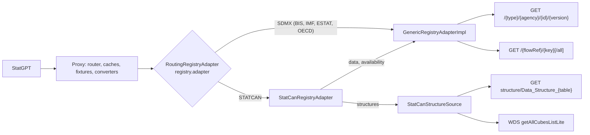
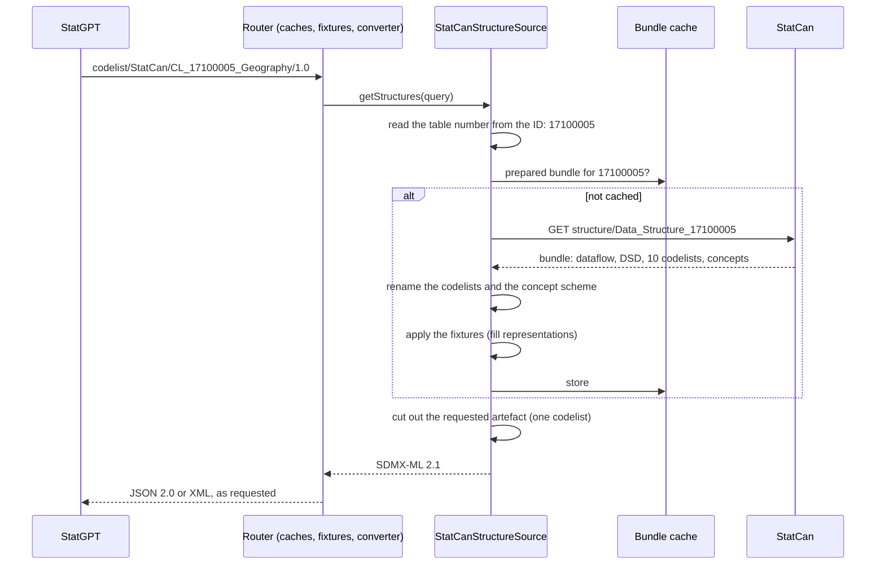
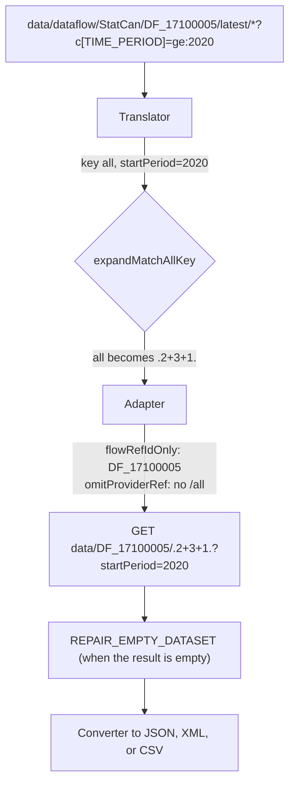
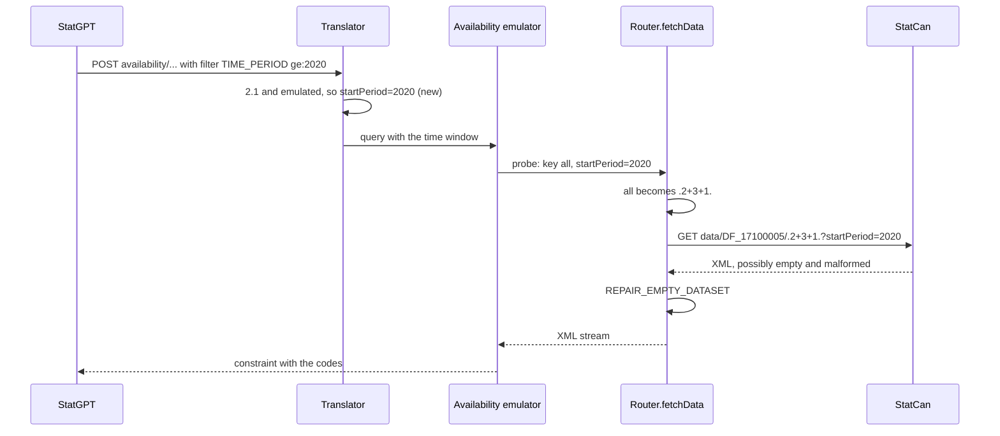

# How the Statistics Canada integration works

This guide explains the solution in [DESIGN.md](DESIGN.md) without the implementation detail: what
is wrong with StatCan, what the proxy does about it, how that differs from the other registries,
and what it affects.

## The problem in one paragraph

StatCan calls its service SDMX 2.1, but it implements only part of it. It has one structure
resource, `structure/Data_Structure_{table}`, which returns all artefacts of one table together
(a *bundle*). It has no dataflow list and no availability. Its data endpoint rejects most URL
shapes, and an empty result comes back as malformed XML. StatGPT asks the proxy for standard SDMX
resources, so the proxy builds what StatCan lacks.

## What changed, in one picture

For BIS, IMF, ESTAT, and OECD, the proxy forwards a request to the registry almost unchanged. For
StatCan, the registry config says `"adapter": "STATCAN"`. Structure requests then go to an
emulator, and data requests get three rewrites driven by config flags.



`GenericRegistryAdapterImpl` holds no StatCan code. Every StatCan class, including its two Feign
clients, lives in `services/adapter/statcan/`. Everything above the adapters works for StatCan
exactly as for the other registries: the router, the caches, the fixtures, and the conversion to
JSON and XML. The emulator answers with ordinary SDMX-ML 2.1, and the router can't tell where it
came from.

## Structures

### What StatGPT asks for and where the answer comes from

| StatGPT request | Source at StatCan |
|-----------------|-------------------|
| `dataflow/all/all/latest` (the catalog) | WDS `getAllCubesListLite`: 8,274 tables, 5,083 of them current |
| `dataflow/StatCan/DF_17100005/latest?references=datastructure` | The bundle of table 17100005 |
| `conceptscheme/StatCan/CONCEPTS_17100005/1.0` | The same bundle |
| `codelist/StatCan/CL_17100005_Geography/1.0` | The same bundle |
| `codelist/StatCan/all/latest` | Nothing: the proxy answers `501`. StatGPT never asks for it |

### How the emulator answers



StatGPT sends about 12 requests per table; StatCan sees one.

### Why the rename

Every bundle names its geography codelist `StatCan:CL_Geography(1.0)`, but the codes differ: 15 in
table 17100005, 30 in table 18100004. One name can't mean two code sets, so the proxy inserts the
table number: `CL_17100005_Geography`, `CONCEPTS_17100005`. The number also lets the proxy find
the right bundle for a later request, and it keeps StatGPT's URL-keyed cache from mixing tables.

sdmx-core upper-cases maintainable IDs, so clients see `CL_17100005_GEOGRAPHY` and
`DATA_STRUCTURE_17100005`. The emulator accepts IDs in any case.

### Why the `FILL_MISSING_REPRESENTATIONS` fixture

StatCan's `OBS_VALUE` has no type, its concepts have no `CoreRepresentation`, and its time
dimension carries an empty `TextFormat`. The fixture fills in what is missing:

- A concept gets the representation of its component; for `Geography` that is the codelist.
- When there is nothing to copy, it gets `String`.
- The time dimension gets `ObservationalTimePeriod`.

The fixture is generic. It changes a document only when the document holds both the DSD and its
concept scheme, and it never overwrites a representation that is already there.

## Data



The following table lists why each rewrite is needed:

| Setting | What StatCan does wrong | What the proxy does |
|---------|------------------------|---------------------|
| `expandMatchAllKey` | `all` returns `400`; `..` returns `404` | Replaces a match-all key with an OR over the codes of the smallest dimension. It selects the same series |
| `flowRefIdOnly` | `StatCan,DF_X,1.0` returns `404` | Sends the bare `DF_X` |
| `omitProviderRef` | `.../key/all` returns `404` | Leaves out the provider segment |
| `REPAIR_EMPTY_DATASET` fixture | An empty result is `<DataSet></Series></DataSet>`, malformed XML | Drops the stray `</Series>` as the stream passes, before any parser reads it |
| `retryOnStatuses: [409]` | Answers `409` while a table updates overnight | Retries the request. The circuit breaker ignores `409` |

All of these are off by default and switched on only in the StatCan config.

## Availability

StatCan has no availability resource, so the proxy uses the emulation from design 040: it sends a
data request (a *probe*) and collects the codes from the response.



Before this change, the time filter never reached a 2.1 probe. Every probe downloaded the whole
table (14&nbsp;MB for 17100005), and the constraint listed codes outside the window. The window
now reaches the probe, for emulated availability only.

## Effect on the other registries

One behavior changes for every registry. Everything else is behind settings that only StatCan
turns on.

| Change | Who it affects | Effect |
|--------|----------------|--------|
| The router passes `BaseException` through on the structure conversion path | All registries | Proxy errors on that path keep their own status: `429` for a rate limit, `501` for an unsupported conversion, `503` for an unavailable cache. Before, all of them became `500` |
| `DataFixtureService` always runs `REPAIR_EMPTY_DATASET` first | Registries that configure that fixture | Only StatCan today |
| The availability probe runs the repair fixture | Registries that configure that fixture | Only StatCan today. Other data fixtures still don't run on the probe |
| The time window reaches the probe | SDMX 2.1 registries with emulated availability | Only StatCan today. IMF 2.1 and OECD have a real availability endpoint and are unaffected |
| `RoutingRegistryAdapter` in front of every adapter call | All registries | A registry without `adapter`, or with `SDMX`, goes to the same `GenericRegistryAdapterImpl` as before |
| New config fields | Nobody | All off by default |

## The StatCan config in brief

The full config is in `sdmx-proxy-config/src/main/resources/sdmx_registries_config.json`. The
following excerpt shows only what differs from an ordinary 2.1 registry:

```json
"adapter": "STATCAN",
"adapterConfig": {"catalogUrl": "https://www150.statcan.gc.ca/t1/wds/rest/", "includeArchived": "false"},

"structureEndpointConfig": {
  "supportedFormats": ["XML_STRUCTURE_2_1"],
  "supportedReferencesForAll": ["none"],
  "fixtures": [{"type": "FILL_MISSING_REPRESENTATIONS"}]
},
"dataEndpointConfig": {
  "flowRefIdOnly": true,
  "omitProviderRef": true,
  "expandMatchAllKey": true,
  "fixtures": [{"type": "REPAIR_EMPTY_DATASET"}]
},
"availabilityEndpointConfig": {
  "availabilityEnabled": false,
  "emulation": {"type": "DATA_QUERY", "unfilteredSource": "PROBE", "probeFormat": "XML_STRUCTURE_SPECIFIC_DATA_2_1"}
},
"resilienceConfig": {"retry": {"retryOnStatuses": [409]}}
```

`adapter` and `adapterConfig` sit on the registry; the endpoint blocks sit under
`versions.SDMX_2_1`.

## Known limitations

- **Key length:** The proxy sends each `+` as `%2B`, so the outbound URL is about 1.5 times as long
  as the client's key. StatCan rejects URLs longer than about 7,500 characters, which caps a
  client key at about 5,000 characters.
- **`limit` is ignored:** It can't be sent to StatCan, and it can't be emulated while availability
  is emulated too.
- **Match-all requests are heavy:** A request for the whole dataflow, and an unfiltered availability
  probe, download the whole table: 14&nbsp;MB in 14 seconds for 17100005.
- **Lists aren't supported:** `codelist/StatCan/all` and similar requests answer `501`.
- **No FREQ dimension:** How StatGPT behaves without a frequency dimension needs a manual check,
  step 15 of the design.
